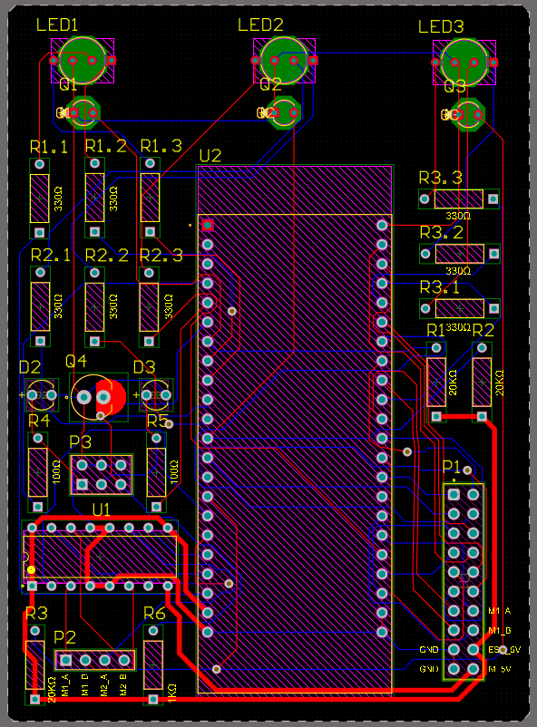
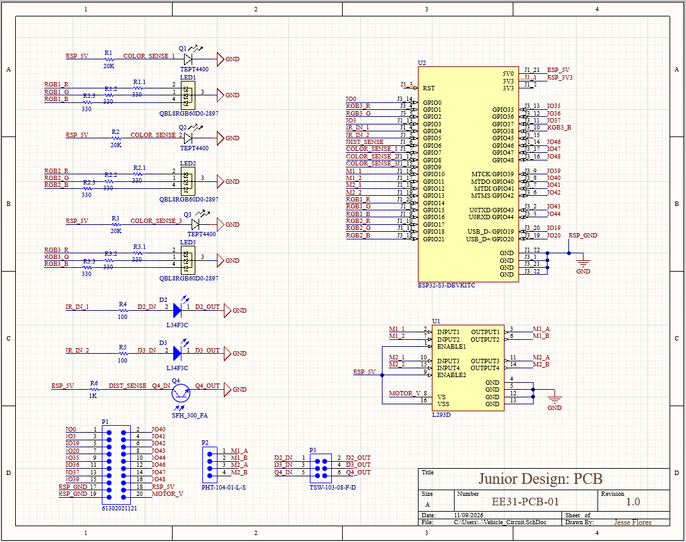

# Altium PCB Files

This branch is primarily managed by Jesse Flores and Dagbegnon Amouzou and will be updated across the semester until completion of EE31: Junior Design at Tufts University.

Board design has been handled by Jesse.

## Final Board Design

Final modification shifting via was added after fabrication and testing of the first finalized version. Minor modification did not require a new fabrication run.

The following schematic describes the final design of the board.

